# GridPulse

**Enterprise Energy Intelligence & Grid Flexibility Platform**

[](https://github.com/matiur25580/GridPulse-Enterprise-Energy-Intelligence-Grid-Flexibility-Platform/actions/workflows/ci.yml)

GridPulse is a multi-tenant energy operations and intelligence platform for organizations managing facilities, electricity meters, renewable generation, tariffs, and flexible energy assets. It brings portfolio visibility, telemetry ingestion, explainable demand intelligence, tariff-aware scenario planning, sustainability reporting, invoice reconciliation, secure gateway integration, and incident operations into one workspace.

> **Product status:** This repository contains a working full-stack implementation across the modules described below. Forecasting and optimization are transparent baseline models and advisory simulations—not autonomous controls or certified utility calculations. Automated alert evaluation is available through a configurable server-side worker, and incident email delivery uses a durable MongoDB outbox with a Resend adapter. A repeatable synthetic demonstration tenant and authenticated Playwright screenshot workflow make product evaluation reproducible. Vendor-specific utility connectors, formal compliance certification, and production-scale validation remain roadmap items. See the limitations section before interpreting modeled outputs.

## Contents

1. [Product vision](#product-vision)
2. [Why GridPulse stands out](#why-gridpulse-stands-out)
3. [Dashboard gallery](#dashboard-gallery)
4. [Demo environment and browser screenshots](#demo-environment-and-browser-screenshots)
5. [Capabilities](#capabilities)
6. [User journeys](#user-journeys)
7. [Architecture](#architecture)
8. [Technology stack](#technology-stack)
9. [Repository structure](#repository-structure)
10. [Getting started](#getting-started)
11. [Environment configuration](#environment-configuration)
12. [Application workflows](#application-workflows)
13. [API reference](#api-reference)
14. [Security and tenant governance](#security-and-tenant-governance)
15. [Data model and ingestion contracts](#data-model-and-ingestion-contracts)
16. [Intelligence methodology and model boundaries](#intelligence-methodology-and-model-boundaries)
17. [Automated alert operations](#automated-alert-operations)
18. [Incident email notifications](#incident-email-notifications)
19. [Testing and continuous integration](#testing-and-continuous-integration)
20. [Deployment checklist](#deployment-checklist)
21. [Operational limitations](#operational-limitations)
22. [Roadmap](#roadmap)
23. [Contributing](#contributing)
24. [License](#license)

---

## Product vision

Energy teams often operate across disconnected meter portals, spreadsheets, supplier invoices, building systems, and renewable-energy dashboards. GridPulse is designed to make those operational signals usable in one organization-aware workflow.

### The problem

- Portfolio teams lack a consistent view of consumption, peak demand, and site performance.
- Telemetry arrives through inconsistent files and gateway integrations, with duplicates and quality gaps.
- Energy forecasts and anomaly flags are difficult to trust when methodology and data coverage are hidden.
- Tariff changes, demand charges, and invoice variances make cost analysis difficult to reproduce.
- Renewable generation and demand-response opportunities are often analyzed separately from facility load.
- Meter outages and stale gateway connections can go unnoticed without a clear incident workflow.

### The GridPulse approach

GridPulse connects asset inventory and telemetry to analytics, planning, reporting, and operations. Every organization-owned query is tenant-scoped; every important estimate exposes its inputs and limitations; and physical equipment remains outside the control plane.

### Intended users

- Energy and sustainability managers
- Facility and plant operations teams
- Utility and energy procurement analysts
- Distributed-energy-resource and demand-response teams
- Multi-site property and manufacturing operators
- Energy consultants and internal portfolio analysts

---

## Why GridPulse stands out

| Differentiator | Practical value |
|---|---|
| Multi-tenant energy operations | A single platform supports separate organizations, memberships, and facilities with server-enforced boundaries. |
| Telemetry provenance and quality | Manual, CSV, and signed gateway ingestion share validation and idempotency rules. |
| Explainable forecasting | Baseline, trend, anomaly thresholds, backtesting, and data requirements are visible. |
| Tariff-aware planning | Time-of-use rates and battery constraints feed reproducible advisory scenarios. |
| Renewable and flexibility modeling | Solar self-consumption, surplus estimates, demand-response scenarios, and indicative avoided emissions share one hourly profile. |
| Invoice reconciliation | Actual supplier invoice entries can be compared with same-period tariff-based estimates. |
| Secure edge integration | Timestamped HMAC webhooks, encrypted signing secrets, key rotation, and source freshness checks. |
| Operational incident lifecycle | Threshold and telemetry-freshness rules create deduplicated incidents with acknowledgement and recovery history. |
| Scheduled evaluation | A configurable worker uses a renewable MongoDB lease to coordinate evaluation across API instances. |
| Honest decision support | Assumptions, missing data, quality exclusions, and non-certified calculations are documented rather than hidden. |

---

## Dashboard gallery

The gallery is intentionally arranged in a **single column** so each workspace preview can be read at presentation size.

**Visual provenance:** These 12 assets are polished, hand-authored SVG interface previews based on the current GridPulse visual language and implemented product modules. They use synthetic sample values to demonstrate layout and information hierarchy. They are **illustrative previews, not pixel captures from a live authenticated tenant or evidence of real customer energy data**. Phase 17 adds an opt-in seeded tenant and a Playwright Chromium workflow that captures twelve authentic screenshots from the running app; the generated PNGs are published as a downloadable workflow artifact and are not silently committed as if they were manually reviewed assets.

### 01 — Portfolio overview

A portfolio-level view of consumption, peak demand, site count, and data quality. It communicates the executive question first: where energy is being used, what is changing, and where operational review may be needed.

<p align="center">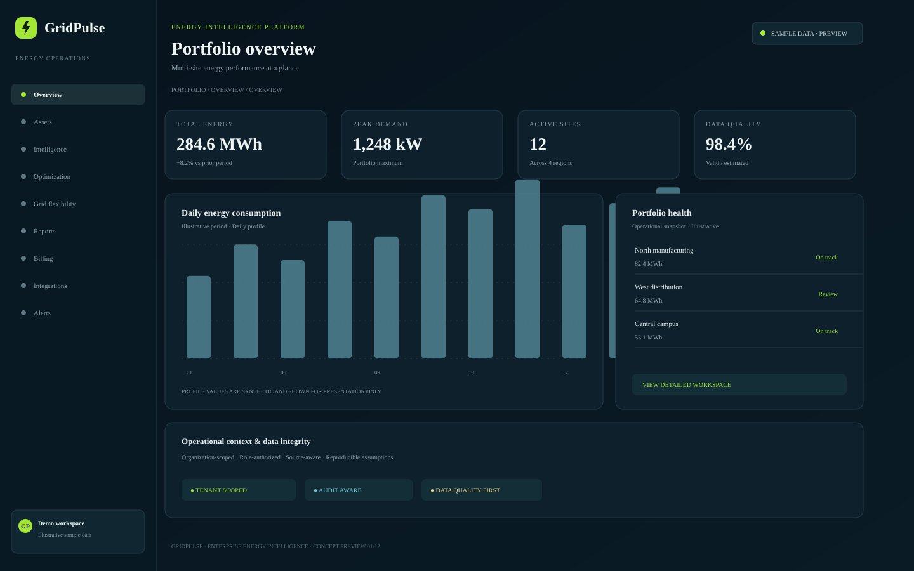</p>

### 02 — Facility and meter operations

An asset-centric workspace for facilities, main meters, submeters, and telemetry coverage. It shows how operational inventory becomes the foundation for trustworthy analytics.

<p align="center">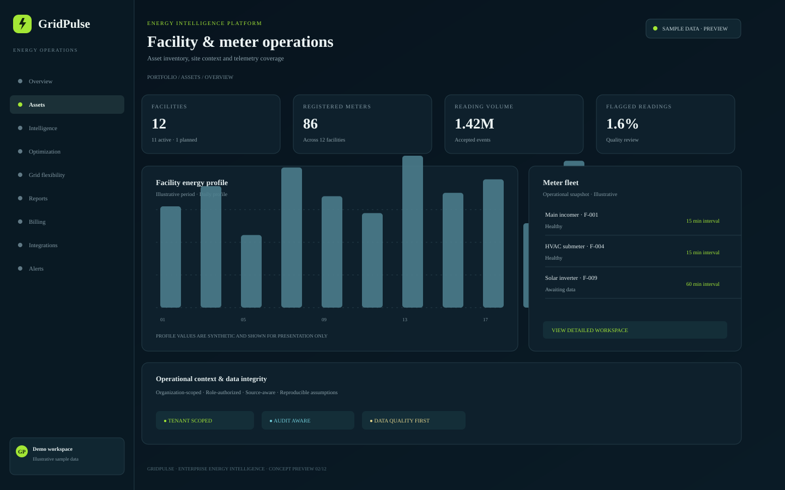</p>

### 03 — Forecasting and anomaly intelligence

An explainable energy-intelligence view combining observed history, a baseline forecast, and unusual-consumption candidates. The design emphasizes reviewable signals instead of opaque model outputs.

<p align="center">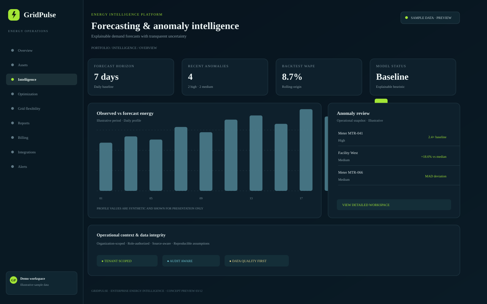</p>

### 04 — Forecast model evaluation

A model-validation view for rolling-origin one-day-ahead predictions, error metrics, and leakage-aware evaluation. It helps an interviewer see that forecast quality is measured rather than asserted.

<p align="center">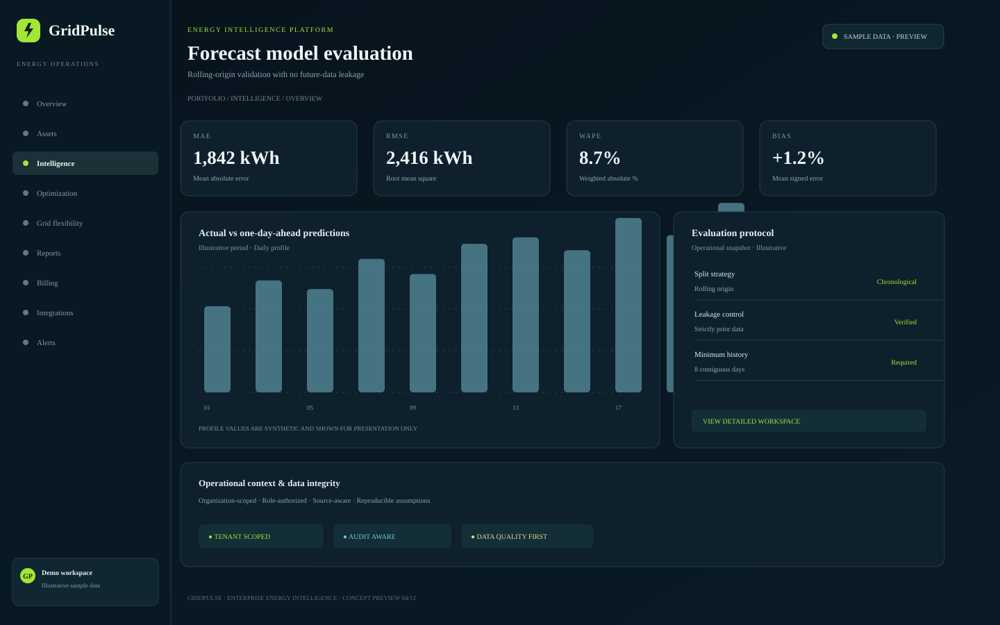</p>

### 05 — Energy optimization

A tariff-aware planning view for battery charge and discharge, modeled cost, savings estimates, and operational constraints. It is designed to explain the trade-offs behind a scenario, not to imply autonomous dispatch.

<p align="center">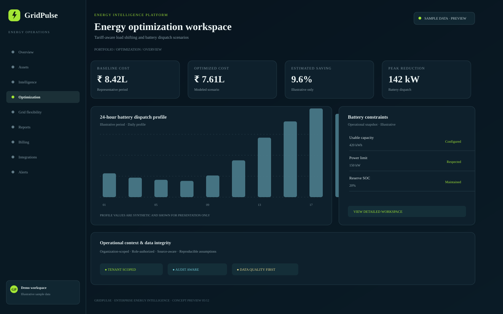</p>

### 06 — Renewable energy and grid flexibility

A combined view of solar generation, self-consumption, demand-response curtailment, and indicative avoided emissions. The visual makes the relationship between local generation and grid import easier to understand.

<p align="center">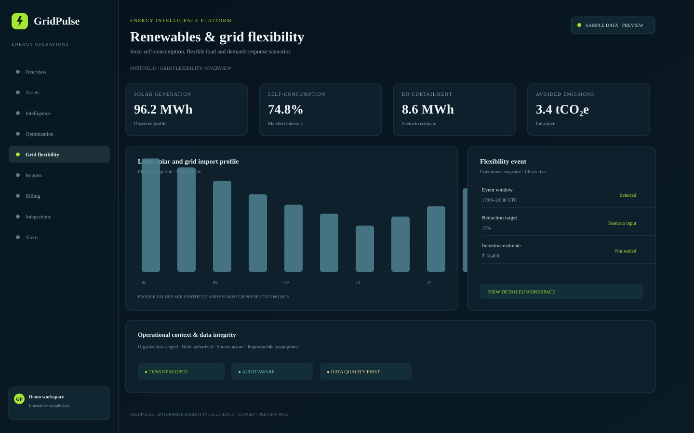</p>

### 07 — Sustainability reporting

A reporting-oriented view of consumption, emissions assumptions, reporting period, and data coverage. The interface makes the emissions factor and source quality visible alongside the headline metrics.

<p align="center">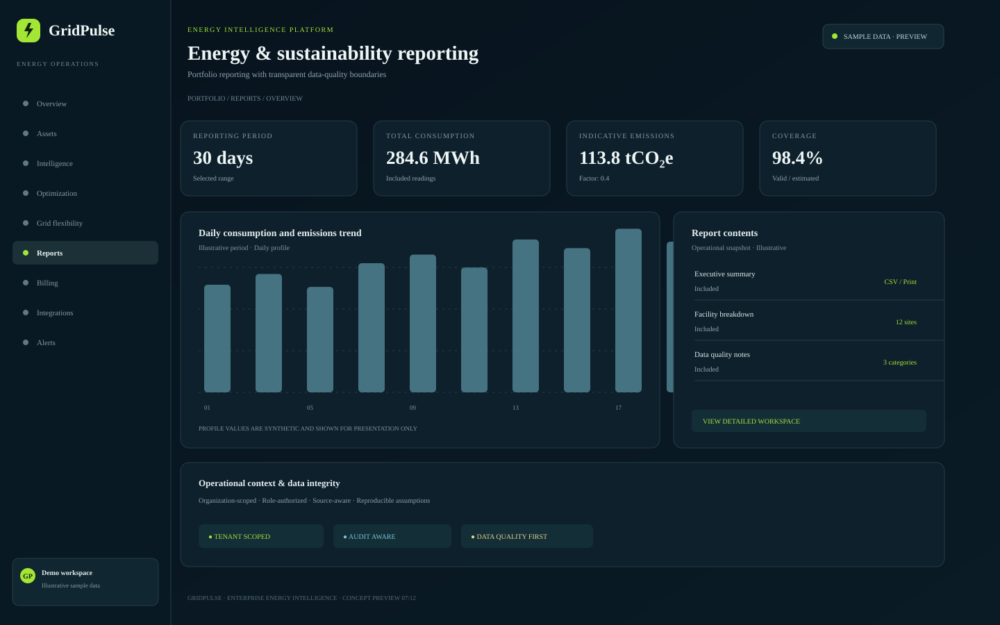</p>

### 08 — Tariff and billing intelligence

A cost workspace for time-of-use periods, tariff versions, energy charges, measured demand charges, and modeled period variance. It communicates how tariff inputs flow into a reproducible estimate.

<p align="center">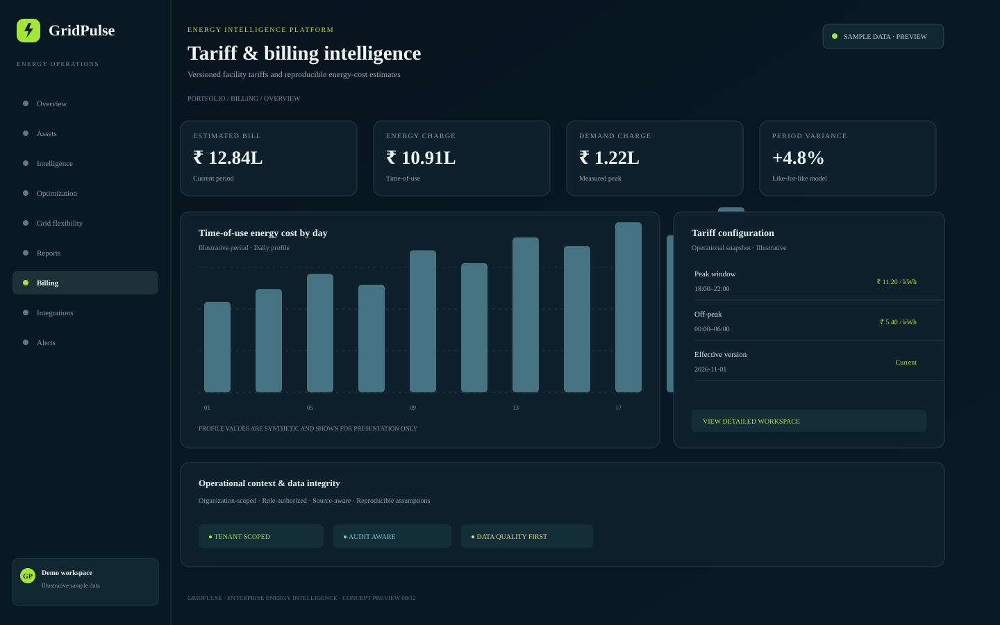</p>

### 09 — Data import and invoice reconciliation

An integration view for batch ingestion outcomes, duplicate handling, invoice records, and variance review. It highlights the operational controls around data entering the platform.

<p align="center">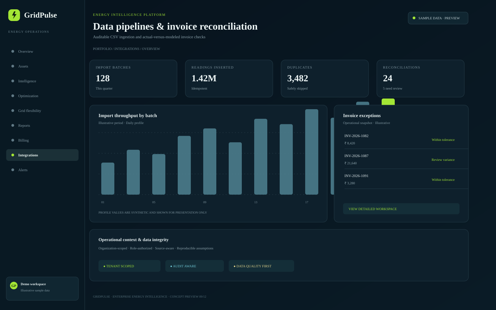</p>

### 10 — IoT gateway security

A gateway operations view for source freshness, event volume, signature verification, and encrypted credential management. It reflects the provider-neutral signed HTTP webhook integration.

<p align="center">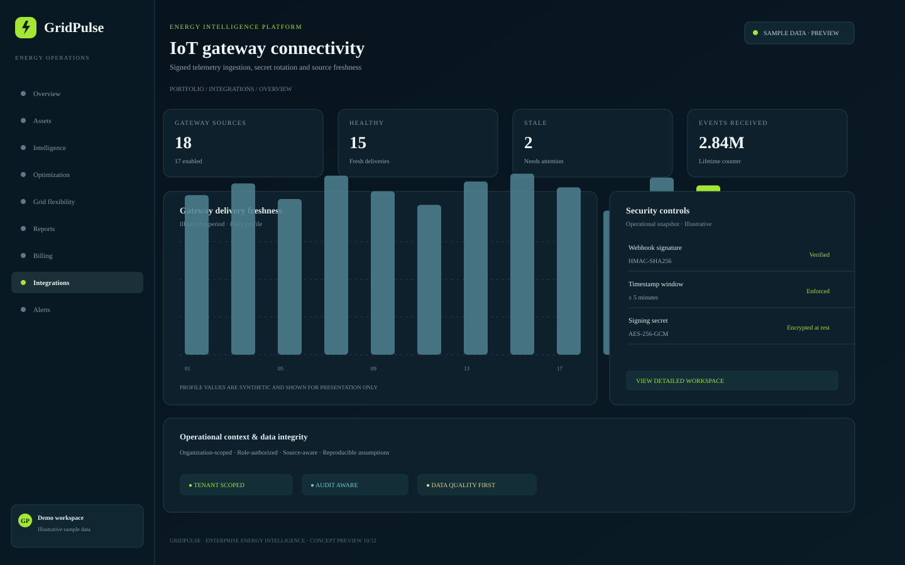</p>

### 11 — Alerts and incident command

An operational incident queue for severity, rule coverage, acknowledgement, and recovery. It demonstrates how telemetry conditions can become actionable work for facility operators.

<p align="center">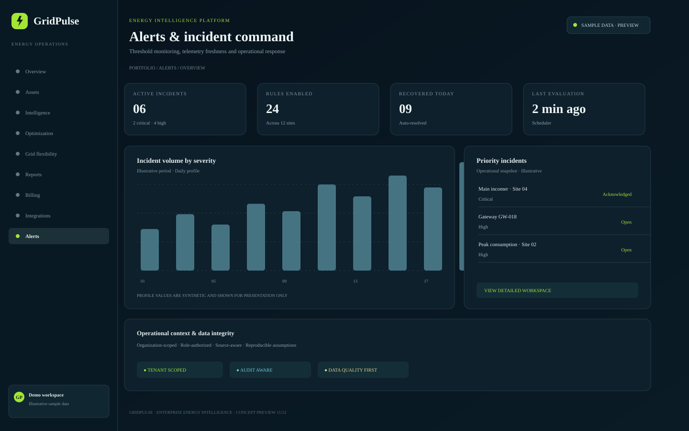</p>

### 12 — Evaluation history and reliability

A run-history view for scheduled and manual evaluations, execution duration, and per-organization outcomes. It provides operational context for the alerting engine and its distributed worker.

<p align="center">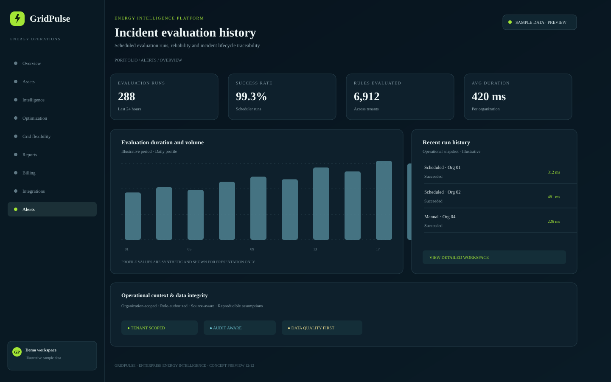</p>

---

## Demo environment and browser screenshots

The repository includes an opt-in demo seeder for a dedicated non-production database. It creates four facilities, ten meters, sixty days of hourly synthetic telemetry, INR time-of-use tariffs, and a sample acknowledged incident. All generated readings are tagged with source `simulation`; no customer or utility data is used. The seeder is idempotent and refuses to run with `NODE_ENV=production`.

Run the seed with a strong local-only password:

```bash
DEMO_SEED_EMAIL=demo@gridpulse.local DEMO_SEED_PASSWORD='Choose-A-Local-Demo-Password-2026' npm run seed:demo
```

See [docs/demo-environment.md](docs/demo-environment.md) for the complete setup, safety boundaries, data profile, and screenshot instructions. The [GridPulse demo gallery workflow](.github/workflows/demo-gallery.yml) launches an ephemeral MongoDB-backed app, signs in through the real UI, exercises the reporting and scenario flows, and captures twelve PNG screenshots with Playwright Chromium.

**Latest successful browser gallery:** [View the GitHub Actions run and download the `gridpulse-dashboard-screenshots` artifact](https://github.com/matiur25580/GridPulse-Enterprise-Energy-Intelligence-Grid-Flexibility-Platform/actions/runs/44921373198). The run completed successfully on 21 November 2026; the artifact contains twelve authenticated browser captures and is retained for 14 days. The workflow fails rather than publishing a gallery if report generation fails validation.

The capture pack contains: portfolio overview, portfolio KPIs, consumption and demand trends, facility and meter operations, forecasting and anomaly intelligence, energy optimization, renewable and grid flexibility, sustainability reporting, tariff and billing intelligence, integrations and reconciliation, alerts and incident command, and incident evaluation history.

The committed SVG gallery remains a lightweight illustrative fallback. It is not represented as a set of production screenshots; the authenticated PNG captures are available from the linked workflow artifact.

## Capabilities

### 1. Organization, identity, and access

- Registration creates a user, organization, and owner membership.
- Login and session restoration use JWT access tokens and rotating refresh sessions.
- Refresh tokens are held in HTTP-only cookies; access tokens remain in client memory.
- Organization memberships support owner, admin, operator, analyst, and viewer roles.
- API middleware verifies active membership for every organization-scoped route.

### 2. Facility and meter management

- Organization-scoped facility and meter inventory.
- Facility timezone and location metadata.
- Main meter, submeter, and solar meter classifications.
- Meter registration against an active facility in the same organization.
- Reading history and manual telemetry entry.

### 3. Energy telemetry

- Batch reading ingestion with quality and source metadata.
- Idempotency by organization, meter, and external event ID.
- Valid, estimated, and flagged reading quality states.
- Optional demand, voltage, current, and power-factor measurements.
- Bounded, paginated reading history.

### 4. Energy intelligence

- Portfolio KPIs, daily consumption, facility breakdown, and data-quality counts.
- Explainable baseline forecast and trend adjustment.
- Meter-level anomaly candidates based on rolling median and median absolute deviation.
- Rolling-origin forecast backtesting with MAE, RMSE, MAPE, WAPE, and bias.
- Facility-level evaluation and actual-versus-predicted history.

### 5. Optimization and battery scenarios

- Peak and off-peak energy-rate inputs.
- Configurable peak hours.
- Battery capacity, power limits, state of charge, reserve, and round-trip efficiency.
- Chronological charge/discharge simulation.
- Modeled baseline and optimized cost, savings, and peak-demand impact.
- Explicit scenario assumptions and data coverage.

### 6. Renewable energy and grid flexibility

- Solar generation profile from active solar-classified meters.
- Main-meter facility load, with disclosed submeter fallback.
- Matched-interval solar self-consumption and surplus estimates.
- Demand-response event windows and hypothetical curtailment percentage.
- Indicative incentive and avoided-emissions calculations.
- Hourly schedule and coverage disclosure.

### 7. Enterprise energy reporting

- Bounded reporting period up to 366 days.
- Portfolio, daily, facility, meter, and quality breakdowns.
- User-supplied grid-emissions factor.
- CSV export and browser print-to-PDF workflow.

### 8. Tariffs, billing, and cost intelligence

- Facility-specific, effective-dated tariff versions.
- Default energy rate and up to twelve time-of-use bands.
- Local facility timezone and weekday/hour matching.
- Fixed service charge, measured demand charge, and configurable tax/surcharge.
- Saved bill-estimate snapshots and same-tariff period comparisons.
- CSV export and illustrative load-shifting opportunity.

### 9. Integrations and invoice reconciliation

- CSV meter import with content fingerprint, batch ID, and replay protection.
- Import outcome counters and batch history.
- Manual utility invoice entry and actual-versus-estimated variance.
- Invoice currency validation and configurable amount tolerance.
- Provider-neutral gateway provisioning and meter mapping.

### 10. Secure IoT gateway ingestion

- 256-bit random gateway signing secrets, shown once at provisioning or rotation.
- AES-256-GCM encrypted credentials at rest.
- HMAC-SHA256 request signatures over timestamp plus exact raw JSON bytes.
- Five-minute timestamp freshness window and constant-time signature comparison.
- Up to 500 events per signed webhook request.
- Meter mapping and organization checks at ingestion.
- Idempotent event processing and gateway freshness state.

### 11. Alerts and incident operations

- High-consumption rules for a facility or meter.
- Meter-silence and gateway-silence rules.
- Configurable severity and freshness/observation windows.
- Deduplicated incidents with occurrence counts and last-seen time.
- Open, acknowledged, and resolved lifecycle.
- Automatic recovery resolution when a later evaluation clears the condition.
- Scheduled and manual evaluation history, including duration and failure status.
- Distributed worker lease to prevent duplicate scheduled evaluation across API replicas.
- 90-day automatic retention for evaluation-run history.

---

## User journeys

### Energy manager

1. Create an organization and register facilities.
2. Add main meters, submeters, and solar meters.
3. Import CSV readings or connect a signed gateway.
4. Review portfolio consumption, demand, and data quality.
5. Inspect forecasts and anomalies, then run backtesting.
6. Configure tariffs and compare estimated energy costs.
7. Generate reports and export CSV/PDF.

### Facility operator

1. Open the organization asset workspace.
2. Check meter and gateway freshness.
3. Review high-consumption or missing-telemetry incidents.
4. Acknowledge an incident and investigate the source.
5. Resolve the incident manually or allow a later evaluation to record recovery.

### Energy analyst

1. Review the forecast methodology and historical backtest.
2. Configure tariff assumptions and battery constraints.
3. Compare baseline and optimized energy-cost scenarios.
4. Evaluate solar self-consumption and demand-response potential.
5. Reconcile supplier invoice values against modeled estimates.

---

## Architecture

GridPulse follows a modular MEVN architecture with explicit boundaries between HTTP routes, request validation, controllers, services, and persistence models.

    Vue 3 + TypeScript + Pinia + ECharts
                    |
             Same-origin API
                    |
          Express 5 / Node.js 22
                    |
    Authentication + tenant authorization
                    |
      Routes -> Zod -> Controllers -> Services
                    |
                Mongoose
                    |
                MongoDB

    CSV imports ---------------------+
    Signed gateway webhooks --------+--> Telemetry ingestion
    Manual readings ----------------+          |
                                               v
       Analytics / Forecast / Billing / Flexibility
                                               |
                           Reports / Alerts / Incidents
                                               |
                         Scheduled evaluator + Mongo lease

### Architectural principles

1. **Tenant scope is mandatory.** Organization IDs in URLs are context only; active membership is independently resolved by the server.
2. **Authorization is server-side.** UI visibility is convenience, never a security boundary.
3. **Ingestion is idempotent.** External event IDs make retries safe.
4. **Inputs and assumptions are explicit.** Forecasts, optimization, billing, and emissions outputs disclose their model boundaries.
5. **Control is advisory.** The platform does not send equipment-control commands.
6. **Secrets are not recoverable through ordinary APIs.** Gateway signing credentials are encrypted at rest and only shown once.
7. **Background work is coordinated.** The alert evaluator uses a MongoDB lease and graceful shutdown handling.
8. **Operational history is bounded.** Evaluation-run history expires after 90 days.

---

## Technology stack

| Layer | Technology |
|---|---|
| Frontend | Vue 3, TypeScript, Vite |
| State and navigation | Pinia, Vue Router |
| Visualization | Apache ECharts, vue-echarts |
| Backend runtime | Node.js 22+ |
| API | Express 5 |
| Database | MongoDB 7+, Mongoose 8 |
| Validation | Zod |
| Authentication | bcryptjs, JWT, rotating refresh sessions |
| Security middleware | Helmet, CORS, cookie-parser |
| Testing | Node.js built-in test runner |
| CI | GitHub Actions |
| Package management | npm workspaces |

---

## Repository structure

    gridpulse/
    ├── .github/
    │   └── workflows/
    │       ├── ci.yml
    │       └── demo-gallery.yml
    ├── client/
    │   └── src/
    │       ├── services/
    │       ├── stores/
    │       ├── App.vue
    │       ├── AssetsView.vue
    │       ├── IntelligenceView.vue
    │       ├── OptimizationView.vue
    │       ├── GridFlexibilityView.vue
    │       ├── ReportingView.vue
    │       ├── BillingView.vue
    │       ├── IntegrationsView.vue
    │       ├── AlertsView.vue
    │       └── style.css
    ├── scripts/
    │   └── capture-demo-gallery.mjs
    ├── server/
    │   ├── scripts/
    │   │   └── seed-demo.js
    │   ├── src/
    │   │   ├── config/
    │   │   ├── controllers/
    │   │   ├── middleware/
    │   │   ├── models/
    │   │   ├── routes/
    │   │   ├── schemas/
    │   │   ├── services/
    │   │   ├── utils/
    │   │   ├── workers/
    │   │   ├── app.js
    │   │   └── server.js
    │   └── test/
    ├── docs/
    │   ├── demo-environment.md
    │   └── screenshots/
    │       ├── 01-portfolio-overview.svg
    │       ├── 02-facility-and-meter-operations.svg
    │       ├── 03-forecasting-anomaly-intelligence.svg
    │       ├── 04-forecast-backtesting.svg
    │       ├── 05-energy-optimization.svg
    │       ├── 06-renewable-grid-flexibility.svg
    │       ├── 07-sustainability-reporting.svg
    │       ├── 08-tariff-and-billing.svg
    │       ├── 09-data-import-reconciliation.svg
    │       ├── 10-iot-gateway-security.svg
    │       ├── 11-alerts-incident-command.svg
    │       └── 12-incident-evaluation-audit.svg
    ├── .env.example
    ├── .nvmrc
    ├── .npmrc
    ├── SECURITY.md
    ├── package.json
    └── README.md

---

## Getting started

### Prerequisites

- Node.js 22 or newer.
- npm 10 or newer.
- MongoDB 7 or newer.
- MongoDB configured as a replica set for registration transactions. MongoDB Atlas is a suitable managed option.

### 1. Clone and install

    git clone https://github.com/matiur25580/GridPulse-Enterprise-Energy-Intelligence-Grid-Flexibility-Platform.git
    cd GridPulse-Enterprise-Energy-Intelligence-Grid-Flexibility-Platform
    npm install

### 2. Configure environment

    cp .env.example .env

Set a MongoDB replica-set connection string and replace the development JWT secret. Generate a gateway encryption key before provisioning gateway sources:

    openssl rand -hex 32

Put the generated value in INTEGRATION_ENCRYPTION_KEY. Never commit the resulting .env file.

### 3. Start the application

    npm run dev

- Vue development application: http://localhost:5173
- Express API: http://localhost:4000
- Health endpoint: http://localhost:4000/api/v1/health

### 4. Run quality checks

    npm test
    npm run build
    npm run check

The test command runs the backend Node.js test suite. The build command runs vue-tsc and the Vite production build.

### Local MongoDB replica-set example

A single-node replica set is sufficient for local development. Start MongoDB with replica-set mode, then initialize it once:

    mongod --replSet rs0 --dbpath ./data/db
    mongosh --eval "rs.initiate()"

Use this connection string in .env:

    MONGODB_URI=mongodb://127.0.0.1:27017/gridpulse?replicaSet=rs0

The exact service commands vary by operating system and MongoDB installation method.

---

## Environment configuration

| Variable | Required | Default / example | Purpose |
|---|---:|---|---|
| NODE_ENV | No | development | Runtime environment |
| API_HOST | No | 0.0.0.0 | API bind host |
| API_PORT | No | 4000 | API port |
| CLIENT_ORIGIN | No | http://localhost:5173 | Credentialed CORS origin |
| MONGODB_URI | Yes | local replica-set URI | MongoDB connection |
| JWT_ACCESS_SECRET | Yes | Replace example | JWT signing secret; minimum 32 characters |
| ACCESS_TOKEN_TTL | No | 15m | Access-token lifetime |
| REFRESH_TOKEN_TTL_DAYS | No | 30 | Refresh-session lifetime; maximum 90 days |
| COOKIE_SECURE | No | false locally | Secure cookie flag; enabled automatically in production |
| INTEGRATION_ENCRYPTION_KEY | Gateway feature | Generate with OpenSSL | Persistent key used to derive the AES-256-GCM gateway-secret encryption key |
| ALERT_EVALUATION_INTERVAL_SECONDS | No | 300 | Scheduled alert interval; set to 0 to disable |
| ALERT_EVALUATION_LEASE_SECONDS | No | 180 | Distributed worker lease duration; renewed while a batch is running |
| ALERT_NOTIFICATION_INTERVAL_SECONDS | No | 15 | Incident email outbox polling cadence; 0 disables delivery |
| RESEND_API_KEY | Optional | — | Resend API key for incident email delivery |
| ALERT_EMAIL_FROM | Optional | — | Verified Resend sender identity |
| DEMO_SEED_EMAIL | Demo only | demo@gridpulse.local | Seed account email; does not affect normal runtime |
| DEMO_SEED_PASSWORD | Demo only | Set explicitly | Local/demo seed account password; never use a production credential |

**Production requirements:** use strong independently generated secrets, HTTPS, a secure cookie domain/configuration, restricted CORS origins, managed MongoDB backups, and secret-manager storage. The gateway encryption key must remain stable across deployments and be backed up securely.

---

## Application workflows

### Authentication and session lifecycle

- Registration creates the user, organization, and owner membership in a MongoDB transaction.
- Login returns a short-lived access token and sets a rotating HTTP-only refresh cookie.
- Refresh rotates the opaque refresh token; only a hash is persisted for the session.
- The frontend holds the access token in memory and coalesces concurrent refresh attempts.
- Logout revokes the current refresh session.
- Organization switching changes request context; it does not bypass membership verification.

### Facilities, meters, and readings

- Facilities have organization-scoped codes and IANA timezones.
- Meters belong to an active facility in the same organization.
- Readings are stored with organization, meter, facility, timestamp, kWh, quality, source, and optional electrical measurements.
- Valid and estimated readings are included in most operational calculations; flagged readings are excluded and reported separately.
- External event IDs are unique per organization and meter.

### CSV meter imports

Required CSV columns:

    externalId,recordedAt,energyKwh

Optional columns:

    demandKw,voltageV,currentA,powerFactor,quality

Timestamps must include Z or an explicit UTC offset. Each batch is limited to 1,000 readings and 900 KB. Batch IDs and SHA-256 content fingerprints prevent accidental replay with changed content. Individual event IDs remain idempotent even when a failed batch is retried.

### Gateway webhook contract

Endpoint:

    POST /api/v1/integrations/gateways/:sourceId/readings

Headers:

    X-GridPulse-Timestamp: <Unix seconds>
    X-GridPulse-Signature: sha256=<lowercase HMAC hex>

The HMAC-SHA256 is calculated over the timestamp, a period separator, and the exact raw JSON request bytes, using the provisioned signing secret as the HMAC key. The timestamp must be within five minutes of server time. Send the same byte sequence that was signed; re-serializing the payload can invalidate the signature.

Example payload:

    {
      "events": [
        {
          "eventId": "edge-01-0000451",
          "externalMeterId": "plant-main-meter",
          "recordedAt": "2026-11-21T10:15:00+05:30",
          "energyKwh": 124.75,
          "demandKw": 498.2,
          "powerFactor": 0.96,
          "quality": "valid"
        }
      ]
    }

Gateway sources support up to 100 meter mappings at the API level and 500 events per delivery. Secrets are returned only during provisioning or rotation. The gateway list endpoint never returns decrypted signing credentials.

### Billing and invoice reconciliation

Tariffs are facility-specific and effective-dated. Time-of-use bands are matched using the facility's timezone and configured weekday/hour ranges. Estimates preserve tariff inputs as snapshots so later tariff changes do not rewrite historical estimates. Invoice reconciliation records actual supplier values and compares them with a newly calculated estimate for the same facility and period.

### Reporting exports

The reporting workspace provides CSV export and browser print-to-PDF. The generated report includes the selected reporting period, summary metrics, daily trend, facility and meter breakdowns, and quality information. The user-supplied emissions factor is shown as an assumption.

---

## API reference

All routes are prefixed with /api/v1. Organization-scoped routes require authentication and an active membership in the organization identified by the URL.

| Method | Endpoint | Access | Purpose |
|---|---|---|---|
| GET | /health | Public | API process health |
| POST | /auth/register | Public | Create user, organization, owner membership |
| POST | /auth/login | Public | Authenticate and issue session |
| POST | /auth/refresh | Refresh cookie | Rotate refresh session |
| POST | /auth/logout | Refresh cookie | Revoke current session |
| GET | /auth/me | Bearer token | Current user and memberships |
| GET | /organizations | Bearer token | List organizations |
| GET | /organizations/:organizationId | Organization member | Organization details |
| GET/POST | /organizations/:organizationId/facilities | Member / owner-admin-operator | List or create facilities |
| GET | /organizations/:organizationId/facilities/:facilityId | Organization member | Facility details |
| GET/POST | /organizations/:organizationId/meters | Member / owner-admin-operator | List or register meters |
| POST | /organizations/:organizationId/meters/:meterId/readings | Owner/admin/operator | Batch reading ingestion |
| GET | /organizations/:organizationId/meters/:meterId/readings | Organization member | Query meter history |
| GET | /organizations/:organizationId/analytics/overview | Organization member | Portfolio energy overview |
| GET | /organizations/:organizationId/analytics/intelligence | Organization member | Forecast, anomalies, backtest |
| POST | /organizations/:organizationId/optimization/simulate | Organization member | Battery and tariff scenario |
| POST | /organizations/:organizationId/grid-flexibility/simulate | Organization member | Solar and demand-response scenario |
| GET | /organizations/:organizationId/reports/energy | Organization member | Energy and emissions report |
| GET/POST | /organizations/:organizationId/billing/tariffs | Member / owner-admin-operator | List or create tariff versions |
| POST | /organizations/:organizationId/billing/bills/estimate | Owner/admin/operator/analyst | Calculate and save bill estimate |
| GET | /organizations/:organizationId/billing/bills | Organization member | Bill estimate history |
| GET | /organizations/:organizationId/billing/bills/:billId | Organization member | Bill estimate snapshot |
| POST | /organizations/:organizationId/meters/:meterId/imports/csv | Owner/admin/operator | Import meter CSV batch |
| GET | /organizations/:organizationId/integrations/meter-imports | Organization member | Import batch history |
| POST | /organizations/:organizationId/integrations/utility-invoices/reconcile | Owner/admin/operator/analyst | Record and reconcile utility invoice |
| GET | /organizations/:organizationId/integrations/utility-invoices | Organization member | Invoice reconciliation history |
| GET | /organizations/:organizationId/integrations/gateways | Organization member | Gateway sources and health |
| POST | /organizations/:organizationId/integrations/gateways | Owner/admin/operator | Provision gateway source |
| POST | /organizations/:organizationId/integrations/gateways/:sourceId/rotate-secret | Owner/admin/operator | Rotate gateway secret |
| PATCH | /organizations/:organizationId/integrations/gateways/:sourceId/status | Owner/admin/operator | Enable or disable gateway |
| POST | /integrations/gateways/:sourceId/readings | HMAC-signed gateway | Receive signed telemetry events |
| GET | /organizations/:organizationId/alerts/rules | Organization member | List alert rules |
| POST | /organizations/:organizationId/alerts/rules | Owner/admin/operator | Create alert rule |
| PATCH | /organizations/:organizationId/alerts/rules/:ruleId | Owner/admin/operator | Enable or disable rule |
| GET | /organizations/:organizationId/alerts/incidents | Organization member | List incident queue |
| POST | /organizations/:organizationId/alerts/evaluate | Owner/admin/operator | Trigger manual rule evaluation |
| GET | /organizations/:organizationId/alerts/evaluations | Organization member | Recent scheduled/manual evaluation history |
| PATCH | /organizations/:organizationId/alerts/incidents/:incidentId | Owner/admin/operator | Acknowledge or resolve incident |

Query parameters and request bodies are validated with Zod. See the corresponding schema and service files for exact bounds and field-level contracts.

---

## Security and tenant governance

### Authentication controls

- bcrypt password hashing.
- Short-lived signed access tokens.
- Opaque rotating refresh tokens stored as hashes.
- HTTP-only refresh cookies with secure production behavior.
- Refresh-session revocation on logout.
- Helmet security headers and explicit credentialed CORS origin.

### Authorization controls

- Active organization membership is required for tenant routes.
- Organization status is checked independently of membership.
- Owner, admin, operator, analyst, and viewer roles are supported.
- Sensitive writes are restricted by role in server middleware.
- Facility, meter, gateway, tariff, bill, import, and incident operations include organization scope.

### Telemetry and integration controls

- Gateway secrets are generated with cryptographic randomness.
- AES-256-GCM protects gateway credentials at rest.
- HMAC signatures authenticate webhook requests.
- Timestamp freshness limits replay opportunities.
- Constant-time signature comparison avoids timing-based signature checks.
- External event IDs prevent duplicate reading insertion.
- Disabled gateways and inactive mapped meters cannot ingest new readings.

### Operational safeguards

- Alert evaluation uses a MongoDB-backed distributed lease.
- Lease ownership is renewed while a scheduled batch is active.
- Graceful shutdown waits for an active alert evaluation before disconnecting MongoDB.
- Evaluation history is organization-scoped and retained for 90 days by a TTL index.
- Error details exposed in evaluation history are sanitized; detailed failures belong in protected server logs.

**Security posture note:** these are implemented application controls, not a claim of SOC 2, ISO 27001, penetration-test, or regulatory certification. A production deployment still requires independent security review, secret rotation procedures, backups, monitoring, incident response, and infrastructure hardening.

---

## Data model and ingestion contracts

Core persisted entities include:

- **User:** identity and password hash.
- **Organization:** tenant boundary and lifecycle status.
- **Membership:** user-to-organization relationship and role.
- **Facility:** site metadata and timezone.
- **Meter:** facility relationship, classification, serial number, and active state.
- **EnergyReading:** time-series energy and electrical measurements, quality, source, and external event ID.
- **TariffPlan:** facility-specific effective-dated rate configuration.
- **EnergyBill:** reproducible estimate snapshot and charge breakdown.
- **GatewaySource:** encrypted secret, external meter mappings, health counters, and delivery freshness.
- **AlertRule:** organization-scoped threshold or silence condition.
- **EnergyIncident:** deduplicated incident lifecycle and acknowledgement/resolution metadata.
- **AlertEvaluationRun:** per-organization scheduled/manual execution outcome and summary.
- **AlertEvaluationLease:** distributed scheduler ownership and expiry.

### Reading quality policy

- **valid:** included in operational calculations.
- **estimated:** included, but counted and disclosed separately.
- **flagged:** excluded from energy, demand, billing, and emissions calculations where the service applies the shared quality policy.

The reading source is retained so teams can distinguish manual, imported, and gateway-delivered measurements.

---

## Intelligence methodology and model boundaries

### Forecasting

The initial forecast is deterministic and explainable:

- Seven-day moving-average baseline.
- Linear trend fitted to up to fourteen observed daily totals.
- Daily trend adjustment capped at 15% of the baseline.
- Heuristic lower and upper bands; they are not calibrated statistical confidence intervals.

### Anomaly detection

- Daily meter consumption is compared with up to fourteen preceding observed days.
- Rolling median and median absolute deviation provide a robust baseline.
- At least seven prior observations are required.
- Severity and baseline/deviation details are exposed for review.

### Forecast backtesting

- Rolling-origin, one-day-ahead evaluation.
- Each prediction uses only strictly earlier observations.
- Only contiguous observed daily points are scored.
- Metrics include MAE, RMSE, MAPE, WAPE, and mean error/bias.
- MAPE excludes zero-actual days.
- At least eight consecutive daily observations are needed for an initial score.

### Optimization

- Representative-day profiles are averaged from observed hourly telemetry.
- Battery dispatch is chronological and respects configured capacity, power, reserve, and round-trip efficiency.
- No future charge is used to serve an earlier peak.
- Missing demand measurements may require an indicative kW proxy derived from energy.
- The simulator is advisory and does not send control commands.

### Renewable and demand response

- Solar-classified meter readings represent generation.
- Main meters represent facility load; submeter fallback is disclosed.
- Self-consumption and surplus estimates require matched load and generation intervals.
- Demand response applies a hypothetical curtailment percentage to modeled grid import.
- Avoided emissions use a user-supplied factor and are indicative, not audited.

### Billing and emissions

- Tariff rates and tax/surcharge inputs are supplied by an authorized organization user.
- Time-of-use matching uses the facility's IANA timezone.
- Demand charges use available measured peak demand; absent demand telemetry is not invented.
- Emissions are calculated from consumption multiplied by a user-supplied factor.
- These are operational estimates, not utility settlement or certified greenhouse-gas inventories.

---

## Automated alert operations

### Supported conditions

| Rule | Target | Evaluation |
|---|---|---|
| High consumption | Facility or meter | Sum valid/estimated kWh inside the configured 5-minute to 7-day window and compare with the threshold. |
| Meter silence | Meter | Compare latest reading timestamp with the configured silence threshold. |
| Gateway silence | Gateway | Compare last successful signed delivery timestamp with the configured silence threshold. |

### Incident lifecycle

- Repeated triggers update the existing open/acknowledged incident instead of creating a new incident on every run.
- Occurrence count, last-seen timestamp, observed value, and threshold are retained.
- Operators can acknowledge or manually resolve an active incident.
- A later evaluation can automatically resolve an incident when the condition clears.
- Disabling a rule resolves its active incident on the next evaluation.
- A future recurrence after resolution creates a new incident.

### Scheduled evaluation

- The API starts the worker after MongoDB connects.
- Default cadence is 300 seconds.
- Set ALERT_EVALUATION_INTERVAL_SECONDS to 0 to disable scheduled evaluation.
- A MongoDB lease coordinates worker ownership across API replicas.
- The lease is renewed during long-running batches and released after evaluation.
- Graceful shutdown waits for an active batch before closing the database connection.
- Organizations with rules are evaluated independently; suspended organizations are excluded.
- Evaluation runs are retained for 90 days and can be inspected through the evaluation-history endpoint.

Manual evaluation remains available from the Alerts workspace. The worker is a periodic evaluator, not a hard real-time or safety-rated alarm system.

**Notification status:** organization-scoped email delivery is available through a durable MongoDB outbox and the Resend adapter. SMS, Slack, Teams, push delivery, quiet hours, and escalation policies remain roadmap items.

---

## Incident email notifications

GridPulse supports durable organization-scoped email delivery for incident lifecycle events.

- Owners and admins can configure up to 25 unique recipient addresses in the Alerts workspace.
- New incidents and automatic recovery or operator-resolution events are written to a MongoDB notification outbox.
- A background worker atomically claims records, processes bounded batches, and recovers expired processing locks.
- Transient delivery failures use exponential backoff; permanent provider failures and exhausted retries move to a dead-letter state.
- Resend idempotency keys protect against duplicate provider submissions when a worker restarts after acceptance.
- The outbox is retained for 90 days. Delivery is at-least-once at the application boundary.

### Provider configuration

Set `RESEND_API_KEY` and `ALERT_EMAIL_FROM` on the API server, then configure organization recipients in **Alerts & incidents → Incident email notifications**. The sender identity must be verified with Resend. `ALERT_NOTIFICATION_INTERVAL_SECONDS` controls polling (default 15 seconds; set to 0 to disable delivery). If provider credentials are absent, the worker stays disabled and queued messages remain pending.

API:
- `GET /api/v1/organizations/:organizationId/alerts/notifications` — owner/admin read.
- `PUT /api/v1/organizations/:organizationId/alerts/notifications` — owner/admin configure recipients.

See [docs/notification-delivery.md](docs/notification-delivery.md) for setup, request examples, delivery behavior, and operational limitations. SMS, push, Slack, Teams, quiet hours, and escalation schedules are not implemented.

---

## Testing and continuous integration

### Run locally

    npm test
    npm run build

The backend suite uses Node's built-in test runner. It includes unit tests for validation, gateway signatures and health, billing logic, alert conditions, and scheduler timing helpers. The frontend build runs TypeScript project checks and Vite bundling. The combined check script runs both in sequence. Node 22 is declared in .nvmrc and npm engine compatibility is enforced through .npmrc.

### GitHub Actions

The workflow at .github/workflows/ci.yml runs on pushes and pull requests targeting main. A separate `.github/workflows/demo-gallery.yml` workflow builds an isolated synthetic tenant and captures twelve authenticated browser screenshots as a downloadable artifact. It uses separate jobs so the frontend build still runs when backend tests fail:

1. Backend job: checks out the repository, installs Node.js 22 and workspace dependencies, then runs the backend test suite.
2. Frontend job: checks out the repository, installs Node.js 22 and workspace dependencies, then runs TypeScript checks and the Vite production build.

A workflow being configured is not proof that a particular commit passed. Check the Actions tab for the latest run and inspect failures before release.

### Current verification note

The repository changes in this milestone were committed through GitHub's repository integration. The execution environment could not create a local checkout because github.com DNS resolution failed, so local commands were unavailable. GitHub Actions is the authoritative verification gate for the committed source; review the latest run on the Actions tab and require both backend tests and the frontend production build to pass before release.

---

## Deployment checklist

This is a deployment checklist, not a claim that a production environment is already provisioned.

### Frontend

- Build with npm run build from the repository root.
- Serve the client build from a static hosting platform or CDN.
- Configure the API proxy/rewrite so browser requests reach the API under the same /api/v1 origin, or explicitly configure a secure API origin and CORS policy.
- Configure the production client origin and HTTPS.

### Backend

- Run Node.js 22 or newer.
- Configure MONGODB_URI to a managed replica-set cluster.
- Set a strong JWT_ACCESS_SECRET and persistent INTEGRATION_ENCRYPTION_KEY.
- Configure CLIENT_ORIGIN to the exact production frontend origin.
- Set COOKIE_SECURE=true and terminate TLS at a trusted ingress.
- Configure ALERT_EVALUATION_INTERVAL_SECONDS and ALERT_EVALUATION_LEASE_SECONDS.
- Ensure only intended application instances can reach MongoDB and gateway ingestion endpoints.
- Configure health checks against /api/v1/health.

### Database and operations

- Enable managed backups and test restore procedures.
- Monitor database connections, query latency, worker errors, and API response times.
- Define log retention and redact credentials/telemetry payloads.
- Back up the gateway encryption key separately from the database.
- Test key rotation, restore, and incident response procedures.
- Use representative seeded demo data in a separate non-production environment for portfolio demonstrations.

---

## Operational limitations

GridPulse is an ambitious portfolio implementation, but the following boundaries are intentional and should be understood before production use:

- Forecasts are deterministic baseline heuristics, not a trained production ML pipeline.
- Forecast uncertainty bands are heuristic, not statistically calibrated confidence intervals.
- Optimization uses simplified representative-day profiles and does not model every utility tariff, degradation, grid constraint, or local-market rule.
- Demand-response results are hypothetical; verified baselines, program qualification, dispatch, measurement and verification, and settlement are not implemented.
- Solar export is estimated from overlapping load/generation intervals, not measured by a revenue-grade export meter.
- Billing is a modeled estimate, not a utility invoice, tax invoice, accounting ledger, or payment system.
- Utility-specific slab rates, power-factor penalties, contracted-demand ratchets, holidays, meter multipliers, export credits, arrears, and jurisdiction-specific tax rules are not fully modeled.
- Emissions factors are user-supplied and not independently certified; reporting is not a verified GHG Protocol inventory.
- Gateway support is a provider-neutral signed HTTP webhook contract. MQTT, Modbus, and vendor cloud connectors are not included.
- Alert evaluation is periodic, not real-time. Email delivery is available through the configured Resend adapter and durable outbox; SMS/push delivery, collaboration-channel adapters, quiet hours, and escalation policies are not included.
- No feature issues physical equipment-control commands.
- Database-backed end-to-end tests, load testing, penetration testing, and independent security review remain necessary before production claims.

---

## Roadmap

| Priority | Next capability | Why it matters |
|---|---|---|
| P0 | Seeded demo environment and real browser-captured screenshots | Seed and Playwright artifact workflow implemented; the first successful workflow run and screenshot review are still required before calling the generated gallery verified. |
| P0 | Database-backed integration tests and tenant-isolation tests | Validates real MongoDB behavior beyond pure unit tests. |
| P1 | Email outbox with Resend delivery adapter | Implemented for incident open/recovery/resolution; collaboration-channel adapters remain future work. |
| P1 | Escalation policies, maintenance windows, and alert suppression | Reduces noise and improves operational workflows. |
| P1 | Utility-provider integrations and scheduled invoice ingestion | Reduces manual reconciliation work. |
| P1 | MQTT/Modbus edge adapters and backfill support | Expands interoperability with industrial telemetry. |
| P2 | Weather/calendar-aware forecasting and trained model registry | Improves forecast accuracy and traceability. |
| P2 | Verified demand-response baselines and measurement/verification | Moves flexibility estimates toward program-grade evidence. |
| P2 | Audit event stream and exportable governance reports | Strengthens enterprise control evidence. |
| P2 | Observability dashboards, SLOs, load tests, and disaster-recovery exercises | Supports operational readiness at scale. |

---

## Contributing

See SECURITY.md for responsible vulnerability disclosure guidance. Contributions should preserve the platform's security and modeling principles.

1. Create a focused branch for each change.
2. Keep organization scope in every tenant-owned query and mutation.
3. Add Zod validation for external inputs.
4. Add tests for new calculations, edge cases, and authorization behavior.
5. Document assumptions, units, timezones, and data-quality rules.
6. Never commit secrets, production data, or customer telemetry.
7. Run npm test and npm run build before opening a pull request.

---

## License

No license has been selected. Unless a license file is added, all rights are reserved by default.